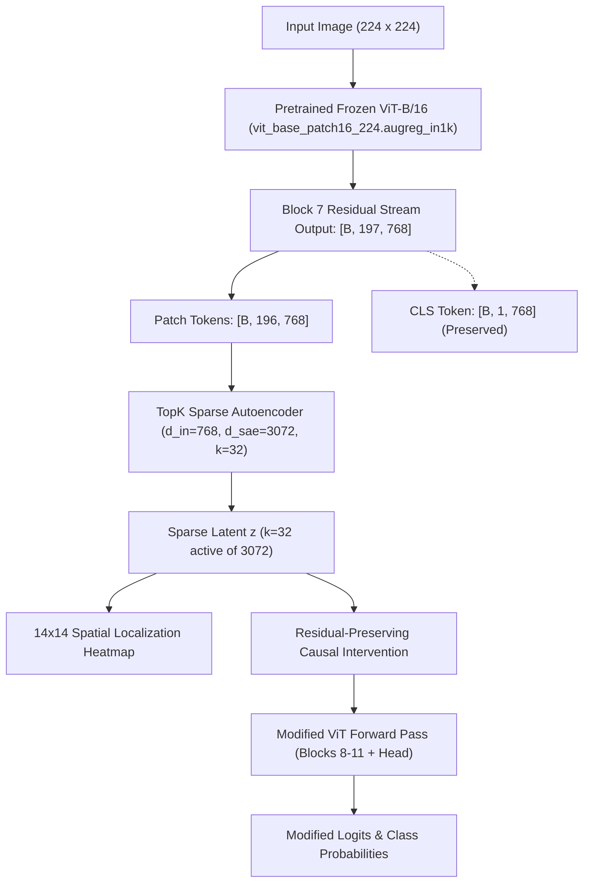

# 🔬 ViT-LENS: Discovering and Causally Testing Interpretable Features in Vision Transformers Using TopK Sparse Autoencoders

[](https://pytorch.org/)
[](https://arxiv.org/abs/2010.11929)
[-green.svg)](https://arxiv.org/abs/2406.04093)
[](https://colab.research.google.com/)
[](https://opensource.org/licenses/MIT)

---

## 1. Project Overview & Research Objective

Modern Vision Transformers (ViT) achieve state-of-the-art accuracy across visual classification benchmarks, yet their internal representations remain largely opaque and polysemantic: individual neurons activate on multiple unrelated concepts due to representation superposition.

**ViT-LENS** is an interpretability and causal testing pipeline designed to:
1. **Dissect internal ViT representations**: Extract Block 7 residual stream activations from a frozen pretrained `vit_base_patch16_224.augreg_in1k` ($[B, 197, 768]$).
2. **Discover sparse visual dictionary features**: Learn a **TopK Sparse Autoencoder (SAE)** ($d_{in}=768 \to d_{sae}=3072, k=32$) enforcing exact $L_0$ sparsity without hyperparameter-sensitive $L_1$ penalties.
3. **Spatially localize visual concepts**: Project patch-token activations across the 196 patch tokens back to a 2D image grid ($14 \times 14 \to 224 \times 224$) with bicubic interpolation and alpha blending.
4. **Causally test visual features**: Execute **residual-preserving causal interventions** directly inside the forward pass of the frozen ViT to experimentally verify whether individual features causally govern classification decisions.
5. **Benchmark against control features**: Guard against confounders by evaluating target feature suppression ($0\times$) and amplification ($2\times$) against distributions of unrelated control SAE features.
6. **Provide an interactive demonstration**: Host the university faculty-ready **ViT-LENS Explorer** dashboard built with Gradio, featuring real-time GPU inference and verified empirical benchmark reports.

---

## 2. Established Empirical Results (Validated in Google Colab)

Our research experiments established the following empirical benchmarks:

| Metric | Result | Description |
|---|---|---|
| **SAE Validation Explained Variance** | **~90.11%** | Measures how accurately the TopK sparse latents reconstruct Block 7 patch activations. |
| **Downstream Prediction Agreement** | **93.6%** | Evaluated on 500 images; tests whether replacing pristine Block 7 patch representations with SAE reconstructions preserves top-1 predictions. |
| **Feature #588 (Fish-associated)** | **AUC 0.9397** | Tested on an independent 200-image class-association evaluation (zero overlap with discovery images). Causal suppression reliably reduces fish logits relative to matched controls. |
| **Feature #1453 (English Springer-associated)** | **AUC 0.9958** | Strongly associated with English Springer spaniels. Causal suppression flips predictions to alternative dog breeds. |
| **Feature #2077 (Fish-associated)** | **AUC 0.9956** | High class association, but matched-control causal intervention was **inconclusive** (controls produced comparable shifts). Highlights the necessity of causal testing beyond correlation. |

> **Scientific Caveat**: Discovered visual features are formulated as *hypotheses* based on empirical observations, not absolute or monosemantic concept detectors.

---

## 3. Theoretical Pipeline & Mathematical Architecture



### The Residual-Preserving Intervention Formula

For a selected SAE feature $i$, let $f_i$ be its activation at each patch token, $\alpha$ the intervention strength, and $d_i$ its SAE decoder direction:

$$x_{edited} = x_{original} + (\alpha - 1) \cdot f_i \cdot d_i$$

Where the decoder direction is calculated exactly as:

$$d_i = \text{sae.decode}(e_i) - \text{sae.decode}(\mathbf{0})$$

This formulation accounts for any decoder bias.

**Core Guarantees:**
- **CLS Token Preservation**: Modifies only the 196 patch tokens; token 0 (CLS) is strictly preserved.
- **Residual Preservation**: Preserves the original unexplained residual $\mathbf{r} = x - \hat{x}$; does not replace activations with full SAE reconstructions.
- **Strict Identity at $\alpha = 1.0$**: At $\alpha = 1.0$, $(\alpha - 1) = 0 \implies x_{edited} = x_{original}$ to machine precision ($< 10^{-7}$).
- **Safe Hook Cleanup**: Forward hooks are automatically registered and removed using `try ... finally` blocks to prevent memory leaks and hook accumulation.

---

## 4. Repository Structure

```text
ViT-LENS/
│
├── README.md                      # Comprehensive faculty & developer documentation
├── requirements.txt               # Pinned Python package dependencies
├── config.yaml                    # Central experiment & architectural configuration
├── .gitignore                     # Git rules (excludes heavy checkpoints, data, activations)
│
├── notebooks/                     # Google Colab notebooks
│   ├── 01_setup_and_dataset.ipynb
│   ├── 02_vit_activation_extraction.ipynb
│   ├── 03_train_topk_sae.ipynb
│   ├── 04_feature_discovery.ipynb
│   ├── 05_causal_intervention.ipynb
│   ├── 06_evaluation_and_demo.ipynb
│   └── 07_final_demo.ipynb        # 🚀 Lightweight zero-retraining launch notebook
│
├── src/                           # Modular research source library
│   ├── __init__.py
│   ├── topk_sae.py                # TopK SAE (k=32, 4x expansion, decoder normalization)
│   ├── vit_model.py               # Pretrained ViT-B/16 wrapper & hook manager
│   ├── model_service.py           # Unified application backend service
│   ├── evidence_service.py        # Empirical results & benchmark metrics provider
│   ├── intervention.py            # Residual-preserving causal hook intervention
│   ├── feature_localization.py    # 14x14 spatial heatmaps & alpha-blended overlays
│   ├── dataset.py                 # Dataset loader & batching
│   ├── activation_extractor.py    # Chunked residual activation streaming
│   ├── feature_explorer.py        # Top-activating patch retrieval & visual montages
│   ├── evaluation.py              # Cohort causal benchmarking & control distributions
│   ├── clip_labeler.py            # Optional zero-shot CLIP concept ranker
│   ├── generate_samples.py        # Generates lightweight demonstration samples
│   └── utils.py                   # Checkpoint resolver, ImageNet-1k labels, device detection
│
├── app/
│   └── gradio_app.py              # Interactive ViT-LENS Explorer dashboard
│
├── tests/                         # Automated unit & integration verification tests
│   ├── test_backend_integration.py # End-to-end integration contracts (shapes, hooks, CLS, math)
│   ├── test_sae.py                # SAE dimensions, decoder norm, TopK L0 sparsity
│   ├── test_activation_shapes.py  # ViT output shapes & chunked dataloader streaming
│   └── test_intervention.py       # Residual preservation math & identity check
│
├── data/samples/                  # Lightweight sample images for faculty demo
└── outputs/features/              # Candidate feature benchmark labels
```

---

## 5. Google Colab University Demonstration

To demonstrate ViT-LENS in Google Colab without retraining or regenerating datasets, open **`notebooks/07_final_demo.ipynb`** or run this single setup cell:

```python
# ==============================================================================
# ViT-LENS: Google Colab Zero-Retraining Demonstration Cell
# ==============================================================================
import os, sys

# 1. Mount Google Drive for persistent checkpoints
from google.colab import drive
drive.mount('/content/drive')

# 2. Clone repository if not already present
if not os.path.exists('/content/ViT-LENS'):
    !git clone https://github.com/your-username/ViT-LENS.git /content/ViT-LENS
sys.path.insert(0, '/content/ViT-LENS')
os.chdir('/content/ViT-LENS')

# 3. Install required UI & model libraries
!pip install -q timm gradio matplotlib pillow pyyaml

# 4. Set optional environment overrides (defaults to Drive checkpoint)
os.environ["VIT_LENS_SAE_CHECKPOINT"] = "/content/drive/MyDrive/ViT-LENS/checkpoints/final_sae_best.pt"
os.environ["VIT_LENS_RESULTS_DIR"] = "/content/drive/MyDrive/ViT-LENS/results"

# 5. Build and launch interactive Gradio application with public share link
from app.gradio_app import build_app
app = build_app()
app.launch(share=True, inbrowser=True)
```

### Environment Variables

| Variable | Description | Default |
|---|---|---|
| `VIT_LENS_SAE_CHECKPOINT` | Absolute path to the trained `final_sae_best.pt` checkpoint | `/content/drive/MyDrive/ViT-LENS/checkpoints/final_sae_best.pt` |
| `VIT_LENS_RESULTS_DIR` | Directory containing Colab evaluation metrics and plots | `/content/drive/MyDrive/ViT-LENS/results` |
| `VIT_LENS_SHARE` | Whether Gradio creates a public link (`true` / `false`) | `true` |

---

## 6. Local Setup & Automated Verification Suite

For local inspection on standard hardware (including 8 GB RAM and integrated GPU):

```bash
# 1. Install dependencies
pip install -r requirements.txt

# 2. Run complete test suite (19 tests)
pytest -v
```

All 19 automated integration and unit tests pass cleanly:
```text
tests/test_activation_shapes.py::test_vit_activation_shapes PASSED       [  5%]
tests/test_activation_shapes.py::test_activation_extractor_chunking PASSED [ 10%]
tests/test_backend_integration.py::test_block7_activation_shape PASSED   [ 15%]
tests/test_backend_integration.py::test_cls_token_preservation PASSED    [ 21%]
tests/test_backend_integration.py::test_spatial_grid_14x14_alignment PASSED [ 26%]
tests/test_backend_integration.py::test_identity_intervention_exact_zero_diff PASSED [ 31%]
tests/test_backend_integration.py::test_hook_cleanup_on_exception PASSED [ 36%]
tests/test_backend_integration.py::test_zero_activation_feature_causes_zero_delta PASSED [ 42%]
tests/test_backend_integration.py::test_checkpoint_validation_and_load PASSED [ 47%]
tests/test_backend_integration.py::test_labels_and_formatting PASSED     [ 52%]
tests/test_backend_integration.py::test_model_service_smoke PASSED       [ 57%]
tests/test_intervention.py::test_residual_preserving_identity PASSED     [ 63%]
tests/test_intervention.py::test_residual_preservation_math PASSED       [ 68%]
tests/test_intervention.py::test_end_to_end_intervention_hook PASSED     [ 73%]
tests/test_sae.py::test_sae_initialization_and_dimensions PASSED         [ 78%]
tests/test_sae.py::test_decoder_unit_norm_constraint PASSED              [ 84%]
tests/test_sae.py::test_topk_sparsity_guarantee PASSED                   [ 89%]
tests/test_sae.py::test_sae_forward_and_reconstruction_shapes PASSED     [ 94%]
tests/test_sae.py::test_dead_feature_tracking_and_resampling PASSED      [100%]
======================= 19 passed, 1 warning in 31.89s ========================
```

---

## 7. Interactive Gradio Interface Sections

The web application (`app/gradio_app.py`) provides an interactive interface structured into 7 sections:
1. **Device & Checkpoint Banner**: Displays compute device (CUDA GPU vs CPU warning), model name, checkpoint loading status, and Google Drive mount guidance.
2. **Image Input & Sample Gallery**: Upload custom images or click sample images (`sample_fish.png`, `sample_springer.png`, `sample_retriever.png`).
3. **Model Prediction & Top-5 Probabilities**: Real forward pass through frozen ViT-B/16 returning ImageNet-1K labels, probabilities, and raw logits.
4. **Active SAE Features Explorer**: Scans all 196 patch tokens with the TopK SAE, ranks active features, and highlights benchmark features (#588, #1453, #2077).
5. **14×14 Spatial Patch Heatmap**: Shows raw 14×14 patch grid activation and bicubic overlay on the original image, with interpretability disclaimers.
6. **Residual-Preserving Causal Intervention**: Slider and preset buttons ($0.0\times$ suppression, $1.0\times$ identity baseline, $2.0\times$ amplification) to execute hooked forward passes and observe logit/probability shifts.
7. **Empirical Evidence & Scientific Findings Accordion**: Summary of verified Colab benchmarks, EV, prediction agreement, and matched-control findings.

---

## 8. Authors & Citation

Built for deep learning interpretability research and demonstration to university faculty.  
Developed using PyTorch, timm, and Gradio.
