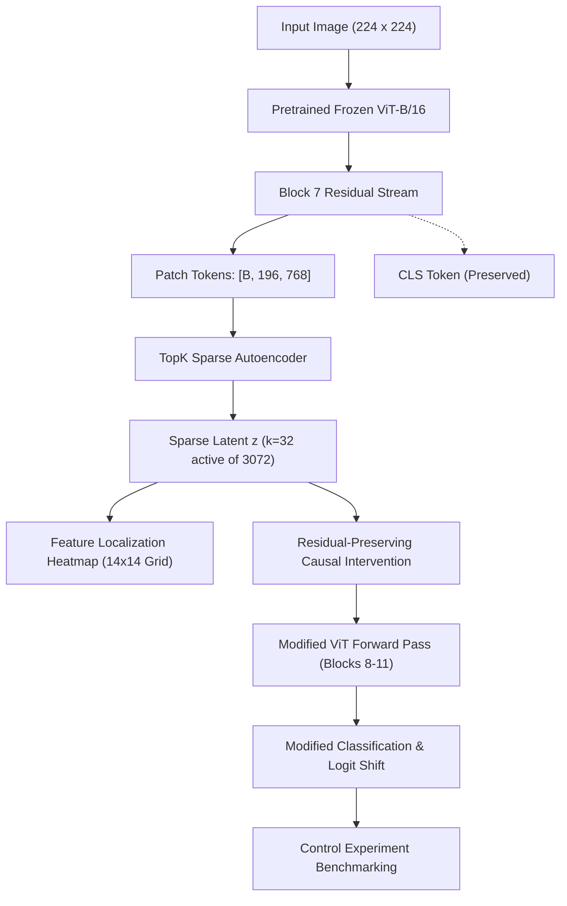

# 🔬 ViT-LENS: Discovering and Causally Testing Interpretable Features in Vision Transformers Using TopK Sparse Autoencoders

[](https://pytorch.org/)
[](https://arxiv.org/abs/2010.11929)
[-green.svg)](https://arxiv.org/abs/2406.04093)
[](https://colab.research.google.com/)
[](https://opensource.org/licenses/MIT)

---

## 1. Project Overview & Research Objective

Modern Vision Transformers (ViT) achieve state-of-the-art accuracy across visual classification benchmarks, yet their internal representations remain largely opaque and polysemantic: individual neurons activate on multiple unrelated concepts due to representation superposition.

**ViT-LENS** is a complete, modular, executable research project designed to:
1. **Dissect internal ViT representations**: Extract residual stream activations from intermediate transformer blocks (Block 7) of a frozen pretrained **ViT-B/16**.
2. **Discover sparse visual dictionary features**: Train a custom **TopK Sparse Autoencoder (SAE)** ($d_{in}=768 \to d_{sae}=3072, k=32$) enforcing exact $L_0$ sparsity without hyperparameter-sensitive $L_1$ penalties.
3. **Spatially localize visual concepts**: Project patch-token activations back to the 2D image plane ($14 \times 14 \to 224 \times 224$) with bicubic interpolation and alpha blending.
4. **Causally test visual features**: Execute **residual-preserving causal interventions** directly inside the forward pass of the frozen ViT to experimentally verify whether individual features causally govern classification decisions.
5. **Benchmark against control features**: Guard against confounders by evaluating target feature suppression ($0\times$) and amplification ($2\times$) against distributions of unrelated control SAE features.
6. **Provide an interactive demonstration**: Host the university faculty-ready **ViT-LENS Explorer** dashboard built with Gradio, featuring both real-time GPU inference and verified precomputed modes.

---

## 2. Theoretical Pipeline & Mathematical Architecture



### The Residual-Preserving Intervention Formula
Given an original intermediate activation $\mathbf{x} \in \mathbb{R}^{d_{model}}$, target SAE feature activation $f_i$, edited strength $f'_i = \alpha \cdot f_i$ (where $\alpha=0.0$ for suppression and $\alpha=2.0$ for amplification), and decoder direction $\mathbf{w}_{dec, i}$:

$$\mathbf{x}_{modified} = \mathbf{x} + (f'_i - f_i) \cdot \mathbf{w}_{dec, i}$$

**Mathematical Invariants:**
- **Residual Preservation**: $\mathbf{x}_{modified} - \hat{\mathbf{x}}_{modified} \equiv \mathbf{x} - \hat{\mathbf{x}}$. The unexplained residual is strictly invariant.
- **Strict Identity at $\alpha = 1.0$**: At $\alpha = 1.0$, $f'_i = f_i \implies \Delta f_i = 0 \implies \mathbf{x}_{modified} = \mathbf{x}$ to machine precision ($< 10^{-7}$).
- **Frozen Parameters**: All ViT weights remain frozen; no fine-tuning or retraining is conducted during intervention.

---

## 3. Repository Structure

```text
ViT-LENS/
│
├── README.md                      # Comprehensive faculty & developer documentation
├── requirements.txt               # Pinned Python package dependencies
├── config.yaml                    # Central experiment & architectural configuration
├── .gitignore                     # Git ignore rules for checkpoints and large tensors
│
├── notebooks/                     # 6 Sequential, executable Google Colab notebooks
│   ├── 01_setup_and_dataset.ipynb
│   ├── 02_vit_activation_extraction.ipynb
│   ├── 03_train_topk_sae.ipynb
│   ├── 04_feature_discovery.ipynb
│   ├── 05_causal_intervention.ipynb
│   └── 06_evaluation_and_demo.ipynb
│
├── src/                           # Modular research source library
│   ├── __init__.py
│   ├── dataset.py                 # Dataset-independent loader & prototype generator
│   ├── vit_model.py               # Pretrained ViT-B/16 wrapper & forward hook manager
│   ├── activation_extractor.py    # Chunked residual activation streaming & caching
│   ├── topk_sae.py                # TopK SAE (k=32, 4x expansion, decoder normalization)
│   ├── sae_trainer.py             # Memory-efficient trainer with resumable checkpoints
│   ├── feature_explorer.py        # Top-activating patch retrieval & visual montages
│   ├── feature_localization.py    # 14x14 spatial heatmaps & alpha-blended overlays
│   ├── clip_labeler.py            # Optional zero-shot CLIP concept ranker
│   ├── intervention.py            # Residual-preserving causal hook intervention
│   ├── evaluation.py              # Cohort causal benchmarking & control distributions
│   ├── generate_precomputed.py    # Generator for genuine demo assets & manifests
│   └── utils.py                   # Device detection, seeding, I/O, and image utilities
│
├── app/
│   └── gradio_app.py              # Interactive ViT-LENS Explorer dashboard
│
├── tests/                         # Automated unit & integration verification tests
│   ├── test_sae.py                # SAE dimensions, decoder norm, TopK L0 sparsity
│   ├── test_activation_shapes.py  # ViT output shapes & chunked dataloader streaming
│   └── test_intervention.py       # Residual preservation math & identity check
│
├── data/                          # Dataset folders & chunked activation cache
├── checkpoints/                   # Checkpoint files (sae_checkpoint_latest.pt)
├── outputs/                       # Research plots, heatmaps, and JSON metrics
└── docs/
    └── implementation_guide.md    # Detailed mathematical derivations & methodology
```

---

## 4. Quickstart: Local Setup & Smoke Tests

For local development on computers with standard RAM and integrated graphics, ViT-LENS includes an integrated CPU smoke test suite and synthetic dataset generator:

```bash
# 1. Clone repository
git clone https://github.com/your-username/ViT-LENS.git
cd ViT-LENS

# 2. Install dependencies
pip install -r requirements.txt

# 3. Run automated verification suite
pytest -v
```

All 10 unit tests pass on standard CPU architectures:
```text
tests/test_activation_shapes.py::test_vit_activation_shapes PASSED       [ 10%]
tests/test_activation_shapes.py::test_activation_extractor_chunking PASSED [ 20%]
tests/test_intervention.py::test_residual_preserving_identity PASSED     [ 30%]
tests/test_intervention.py::test_residual_preservation_math PASSED       [ 40%]
tests/test_intervention.py::test_end_to_end_intervention_hook PASSED     [ 50%]
tests/test_sae.py::test_sae_initialization_and_dimensions PASSED         [ 60%]
tests/test_sae.py::test_decoder_unit_norm_constraint PASSED              [ 70%]
tests/test_sae.py::test_topk_sparsity_guarantee PASSED                   [ 80%]
tests/test_sae.py::test_sae_forward_and_reconstruction_shapes PASSED     [ 90%]
tests/test_sae.py::test_dead_feature_tracking_and_resampling PASSED      [100%]
============================= 10 passed in 13.87s =============================
```

---

## 5. Google Colab Execution Workflow

The full-scale experiments are orchestrated across 6 sequential Google Colab notebooks:

| Notebook | Title | Key Operations |
|---|---|---|
| **01** | `01_setup_and_dataset.ipynb` | Google Drive mount, dependency setup, GPU verification, dataset loading & ImageNet-100 class mapping. |
| **02** | `02_vit_activation_extraction.ipynb` | Load frozen ViT-B/16, attach Block 7 forward hook, extract patch activations into chunked `.pt` files. |
| **03** | `03_train_topk_sae.ipynb` | Train TopK SAE ($d_{sae}=3072, k=32$) on activation chunks with periodic Google Drive checkpointing. |
| **04** | `04_feature_discovery.ipynb` | Scan dataset, extract top-activating patches, generate visual grids, and produce 14×14 spatial heatmaps. |
| **05** | `05_causal_intervention.ipynb` | Execute residual-preserving suppression ($0\times$) & amplification ($2\times$) inside the ViT forward pass. |
| **06** | `06_evaluation_and_demo.ipynb` | Run control experiments, evaluate flip rates, export results, and launch the Gradio ViT-LENS Explorer. |

---

## 6. Launching the ViT-LENS Explorer Dashboard

The interactive web dashboard can be launched locally or shared via a public link on Colab:

```bash
python app/gradio_app.py
```

### Dashboard Modes:
1. **Live Mode**: When PyTorch and model weights are initialized, runs dynamic ViT inference, live 14×14 spatial localization heatmaps, and on-the-fly causal slider interventions.
2. **Precomputed Mode**: When GPU resources are constrained or demonstrating offline, surfaces genuine pre-recorded experiment results with explicit labeling.

---

## 7. Scientific Safeguards & Research Principles

1. **Hypothesis Status**: Discovered features (e.g. Feature #127: "Fur Texture") are formulated as *hypotheses* based on empirical observations, not absolute ground truths.
2. **Confounder Control**: Single-feature interventions are always contrasted against a baseline distribution of 5–10 unrelated control features to separate general activation disruption from targeted semantic causality.
3. **Residual Preservation**: Preserving the unexplained residual $\mathbf{r}$ ensures the network remains in-distribution during feature perturbations.

---

## 8. Authors & Citation

Built for deep learning interpretability research and demonstration to university faculty.  
Developed using PyTorch, timm, and Gradio.

